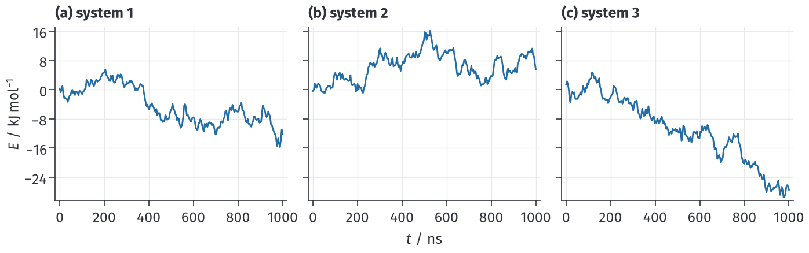

# MVDLib

[](https://www.python.org/)
[](https://lbesson.mit-license.org/)

The lab's Matplotlib plotting style and plotting helpers. Use it so that
figures across lab projects and publications share one consistent look.



## Installation

### Pixi (recommended)

After configuring the lab Pixi channel (see
[mvondomaros-lab.github.io](https://mvondomaros-lab.github.io)), install with:

```console
pixi add mvdlib
```

### PyPI

```console
pip install mvdlib
```

## Usage

```python
import matplotlib.pyplot as plt

from mvdlib.plots import axis_label, set_nticks, subplots
from mvdlib.style import BASE

plt.style.use("mvdlib.style.default")

fig, ax = subplots()  # a 2.0 × 1.5 in panel; the figure fits around it
ax.plot(t, energy, color=BASE)
ax.set_xlabel(axis_label("t", "ns"))
ax.set_ylabel(axis_label("E", "kJ mol^{-1}"))
set_nticks(ax)
fig.savefig("energy.pdf")
```

The [style guide](https://mvondomaros-lab.github.io/mvdlib/) explains the
conventions, with examples at their printed size
([source](docs/styleguide.md)).

## Contents

- `mvdlib.style`
  - `default.mplstyle`: the style sheet, activated with
    `plt.style.use("mvdlib.style.default")`.
  - The colour system: `INK`, `GRID`, `BASE`, the highlights `H1`–`H3`, the
    colour cycle `LINES`, and the colormaps `SEQ` and `DIV` (registered as
    `mvdlib_seq` and `mvdlib_div`).
  - Fira Sans, bundled and registered on import.
- `mvdlib.plots`
  - `subplots`: figures with fixed panel sizes, so panels are equally large
    across figures; `PANEL` and the `ACS_*_COLUMN` widths.
  - `colorbar`: a colour bar that does not shrink its panel.
  - `axis_label`: *quantity / unit* axis labels.
  - `panel_labels`: (a), (b), ... panel labels.
  - `set_nticks`: limit the number of major ticks.
  - `plot_contour`: a colour mesh with contour lines.
  - `plot_kde`: a kernel density estimate.

## Development

```console
pixi run pytest        # run the tests
pixi run gallery       # re-render docs/figures after changing the style
pixi run site          # build the style guide website into site/
```

## License

MIT. The bundled Fira Sans fonts are licensed under the SIL Open Font License
1.1 (`mvdlib/style/fonts/OFL.txt`). The colormaps are derived from seaborn
(BSD 3-Clause License).
