# Style guide

How we make figures in the lab. The style sheet handles most of it; this guide
covers the choices it cannot make for you. Every figure below is rendered by
[`gallery.py`](gallery.py); regenerate them with `pixi run gallery`.

The figures are shown at their printed size, at 96 px per inch, so text sizes,
line weights, and panels compare across figures. Markdown viewers such as
GitHub and VS Code shrink figures wider than the text column; the
[website](https://mvondomaros-lab.github.io/mvdlib/) never does, and is the
reference for judging sizes.

```python
import matplotlib.pyplot as plt

from mvdlib.plots import (
    ACS_SINGLE_COLUMN,
    axis_label,
    colorbar,
    panel_labels,
    set_nticks,
    subplots,
)
from mvdlib.style import BASE, H1, H2, H3, INK, LINES, SEQ, DIV

plt.style.use("mvdlib.style.default")
```

## Principles

- **Data over decoration.** Structure (axes, ticks, text) is drawn in a muted
  ink, thinner than the data. Grids are faint, top and right spines are
  removed, and legends have no frame.
- **One colour by default.** Draw data in `BASE`. Add a highlight only when it
  carries meaning, and never use colour as the only way to tell series apart
  when there are more than four.
- **Print first.** Sizes, fonts, and line weights are chosen for a printed
  journal column at 100 % scale, not for the screen.

## Figure size

Fix the size of the panels, not of the figure. A panel is the visible axes
box, the area inside the axis lines; it is what the reader compares between
figures. Create figures with `subplots`, which keeps every panel at the same
size and grows the figure around it to fit tick labels, axis labels, titles,
and colour bars:

```python
fig, ax = subplots()                             # one 2.0 × 1.5 in panel
fig, axes = subplots(1, 3, sharey=True)          # three of them
fig, ax = subplots(panel=(1.5, 1.5))             # a square map
fig, ax = subplots(max_width=ACS_SINGLE_COLUMN)  # warn if too wide
```

Use one panel size for all figures of a paper, so that single- and
multi-panel figures sit side by side at the same scale. Pick it from the most
crowded layout the paper needs. For ACS journals (at most 3.25 in for one
column and 7 in for two), with the style's 9 pt text:

| Widest layout in the paper | Largest panel width |
| --- | --- |
| 1 panel in a single column | 2.7 in |
| 1 panel with a colour bar in a single column | 2.15 in |
| 2 panels in a double column | 3.0 in |
| 3 panels with a shared y-axis in a double column | 2.0 in |
| 3 panels with separate y-axes in a double column | 1.8 in |
| 4 panels with a shared y-axis in a double column | 1.45 in |

The default panel, `PANEL = (2.0, 1.5)`, fits three panels in a row. Journal
column widths are maximums: a figure narrower than the column is fine. For
other journals, pass their widths as `max_width`.

Plain `plt.subplots` figures use constrained layout, which fits panels into a
fixed figure size. Use them for quick looks, not for publication.

## Axis labels

Label axes as *quantity / unit* (ISO 80000-1): the quantity divided by its unit
is a pure number, which is what the tick labels show. Write negative exponents
instead of fractions in the unit.

```python
ax.set_xlabel(axis_label("t", "ns"))           # t / ns
ax.set_ylabel(axis_label("E", "kJ mol^{-1}"))  # E / kJ mol⁻¹
ax.set_ylabel(axis_label(r"\rho"))             # dimensionless: ρ
```

The quantity is set in italics and the unit upright, both in Fira Sans.
Prefer symbols over words for quantities, and explain them in the caption.

Keep tick labels sparse: `set_nticks(ax)` limits each axis to at most six
intervals at round values.

## Colours

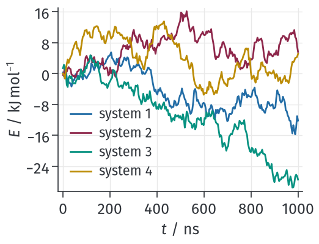

| Name | Role |
| --- | --- |
| `INK` `#30343A` | Text, axes, ticks, and reference lines. |
| `BASE` `#236DA6` | Primary data. Most figures need nothing else. |
| `H1` `#8E274B` | First highlight. |
| `H2` `#079281` | Second highlight. |
| `H3` `#BC8C06` | Third highlight. |
| `GRID` `#E9E9E9` | Grid lines. |

`LINES` is the colour cycle, in the order above. The colours differ in
lightness (`H1` darkest, `H3` lightest), so they stay distinguishable in
greyscale and for readers with colour vision deficiencies; the test suite
checks this. If you need more than four series, use a sequential colormap
(below) or small multiples instead.

## Highlights and transparency

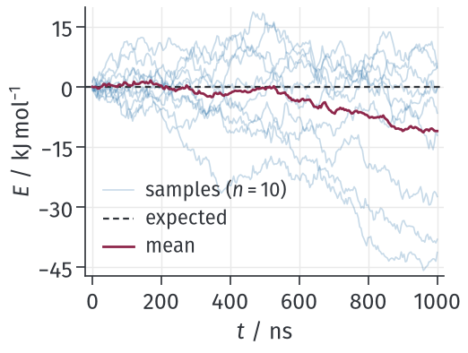

De-emphasise individual traces with thin, transparent `BASE` lines, reserve a
highlight for the aggregate, and draw references in dashed `INK`. Use `zorder`
to put the highlight on top.

## Uncertainty

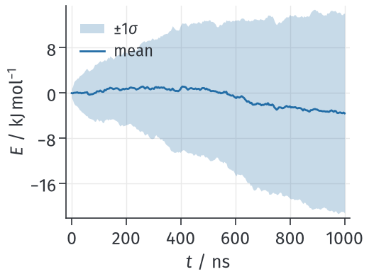

Show uncertainty as a transparent band in the colour of its line, and say in
the legend or caption what the band means (standard deviation, standard error,
confidence interval).

## Sequential colours

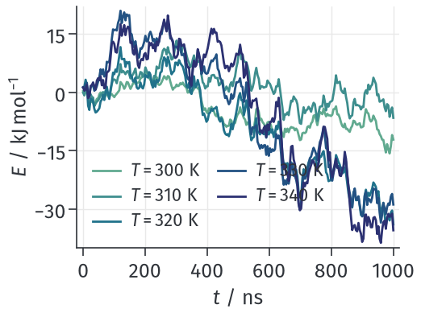

When series are ordered by a hidden variable, such as temperature or time,
sample their colours from `SEQ` instead of the colour cycle. Skip the lightest
quarter of the colormap, which is too faint for lines:
`SEQ(np.linspace(0.25, 1.0, n))`.

## Multi-panel layouts

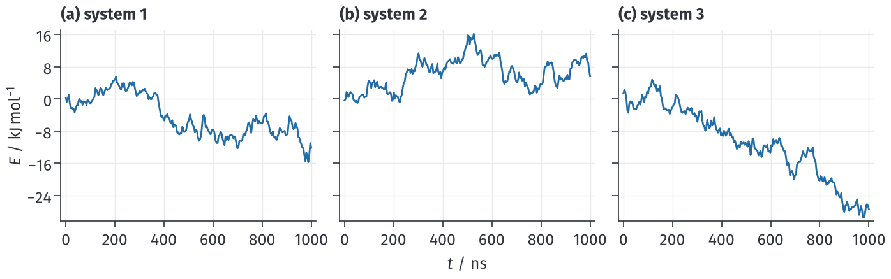

Arrange panels in columns to share the y-axis and in rows to share the x-axis,
and label each shared axis once with `fig.supxlabel` or `fig.supylabel`.
Label panels with `panel_labels(axes)`, which prefixes the bold left-aligned
title, e.g. *(a) system 1*.

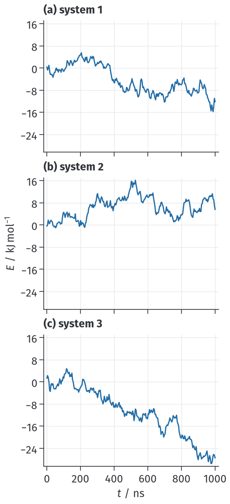

## Maps and contours

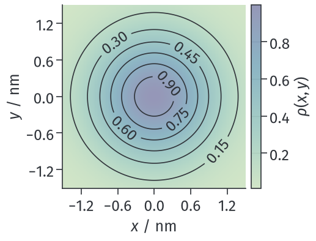

Show a function of two variables as a colour mesh with contour lines, and
always add a colour bar with `colorbar(ax, mesh)`, which places it next to
the panel without shrinking it. `plot_contour` draws a semi-transparent mesh
so the contours stay legible; the colour bar inherits the transparency.

When both axes share a unit, use `ax.set_aspect("equal")` on a square panel,
e.g. `subplots(panel=(1.5, 1.5))`, the default panel height squared. On other
panels, `subplots` keeps the panel size and extends the data limits instead.

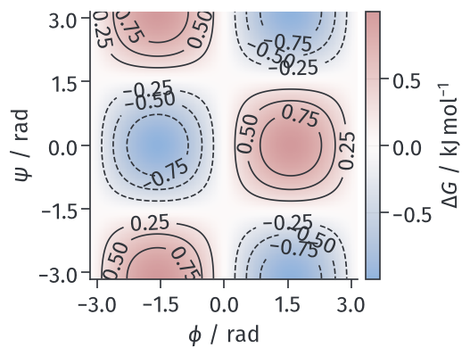

Use `DIV` for data that diverge from a meaningful centre, such as differences
or free energies relative to a reference, and centre the colormap on it with
`norm=CenteredNorm()`. Negative contours are dashed.

## Bars

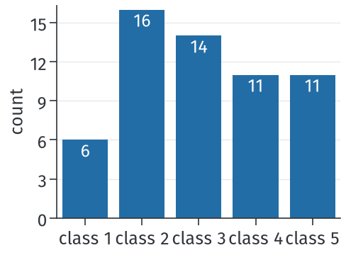

Write the values on the bars with `ax.bar_label` and drop the vertical grid.
Bars start at zero; if they cannot, use points instead.

## Distributions

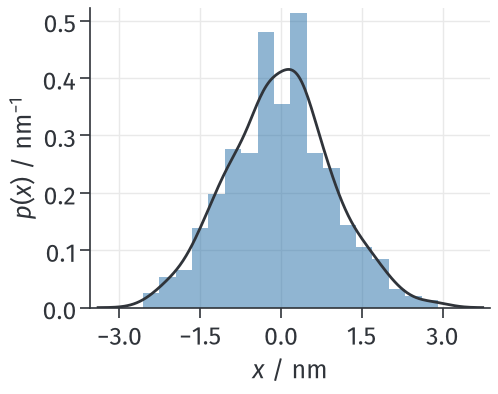

Show a distribution as a histogram with a kernel density estimate on top.
`plot_kde` extends the curve three bandwidths beyond the data, so it decays to
zero, and draws it filled with `fill=True`.

## Logarithmic axes

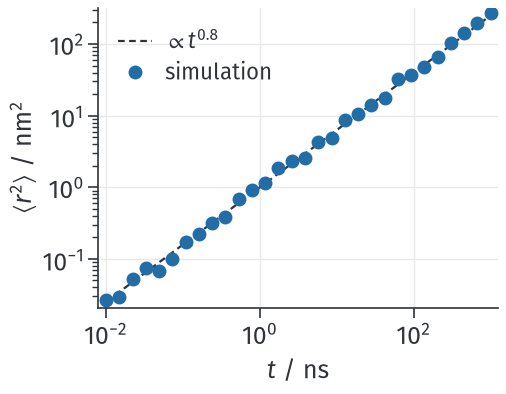

Minor ticks are off by default. Turn them on with `ax.minorticks_on()` on
logarithmic axes, where they show the scale. Draw a power-law guide in dashed
`INK`.

## Legends

Legends are frameless and use 8 pt text. Place them where they cover no data,
and order their entries as the series appear in the plot. For a few lines,
consider labelling them directly with `ax.text` at their ends instead.

## Saving figures

```python
fig.savefig("figure.pdf")  # vector, for submission
fig.savefig("figure.png")  # raster, 600 dpi
```

Prefer PDF or SVG. The style embeds fonts as TrueType (`pdf.fonttype: 42`),
which journals accept and which keeps text editable in Illustrator or
Inkscape. Raster output uses 600 dpi. Do not use `bbox_inches="tight"`:
`subplots` already fits the figure to its content, and cropping would change
the printed size.
